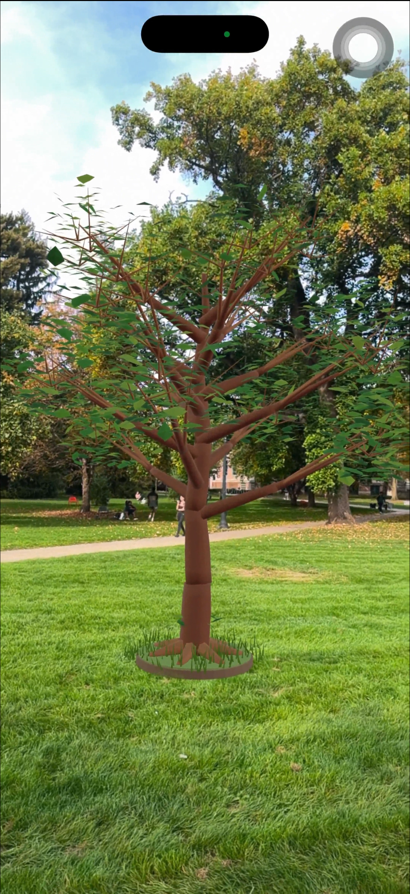

# Rooted in Time — Found on the Oval

DESIGN 4106 · Intro to AR Training 2

## Project Deliverables

- **Title:** Rooted in Time
- **Names:** Freya&Wenxi
- **Live page:** [https://github.com/fwang20060226-glitch/oval.git]
- **Coordinates:** 39.999570, -83.013125
- **Intent:** By revealing a growing tree on the Oval’s lawn, our AR experience makes the gradual growth behind this familiar campus landscape visible in a single visit.
- **Screenshot:** See the on-site AR screenshot below.
- **Video:** Submitted separately on Carmen as a stable MP4 recording under two minutes, showing both the approach and unlock, followed by AR placement.

## Concept and Development

Our initial idea was to show the changing seasons on a patch of grass. We wanted participants to encounter a familiar part of the Oval and see the changes that normally unfold too slowly to notice during a single visit.

We built a seasonal animation in Blender, but encountered several technical challenges. Some animation effects did not transfer reliably to our AR workflow, the exported animations were split into separate clips, and the model exceeded the assignment’s 5 MB file-size limit. Our initial video work:[https://youtu.be/vVoqFclYDIQ]

We simplified the concept to a tree growing from a seedling into a mature tree. This preserved our interest in time and natural change while making the animation more suitable for AR. We also refined the tree with individual leaves, smaller branches, and details around its roots.

The location matters because the Oval’s lawn and trees form a landscape we often pass through without noticing its gradual changes. Requiring participants to physically reach the spot connects the digital growth to the real ground where they are standing.

## Model and AR

The tree uses simple mesh geometry and animated transformations. Its growth is combined into one animation clip lasting approximately 18 seconds.

- **GLB size:** Approximately 3.70 MB
- **Scale:** 1 unit = 1 metre
- **Mature tree height:** Approximately 4.9 metres
- **Web model:** `models/1122.glb`
- **Background audio:** `audio/ovalbgm.mp3`

The GLB is used for the web preview. A separate animated USDZ is provided for iPhone and iPad AR because the automatic conversion used by our webpage did not preserve the growth animation.

Background music begins after pressing Start, with a play/pause control on the webpage.

## Test on Your Computer

1. Open the project folder in VS Code.
2. Install the Live Server extension if needed.
3. Right-click `index.html` and select **Open with Live Server**.
4. Add `?fake` to the address.
5. Click **Start** to simulate approaching the spot and test the unlock and growth animation.

## Test on Location

1. Open the published GitHub Pages website on your phone.
2. Make sure the URL does not contain `?fake` or `?scout`.
3. Tap **Start** and allow location access.
4. Walk toward **39.999570, -83.013125**.
5. Once inside the unlock radius, the model appears and the growth animation starts.
6. Tap **View in AR** and place the tree on the ground.
7. Check its placement, physical scale, and animation on the device.

## How It Works

The webpage uses the phone’s GPS to calculate the distance to the selected spot. The model remains hidden until the participant enters the unlock radius.

The coordinates are set in `TARGET`, and the unlock radius is set in `RADIUS` in `index.html`.

## Credits

Built from the course’s
[geo-model-viewer starter](https://github.com/robillardstudio/geo-model-viewer-starter)
using [model-viewer](https://modelviewer.dev/).

The project was developed through iterative Blender and web testing, with AI assistance for troubleshooting, tree-model generation, animation export, and webpage integration.