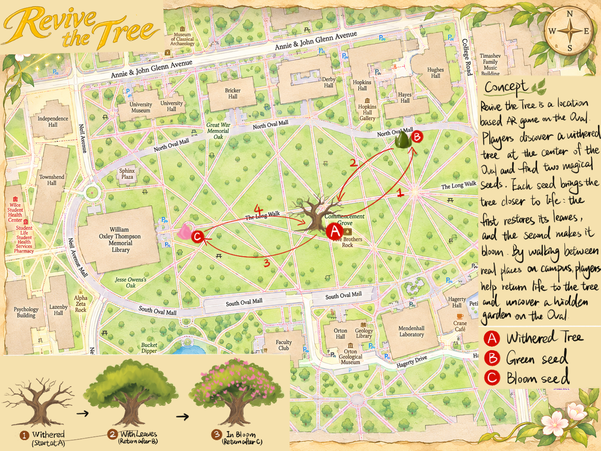
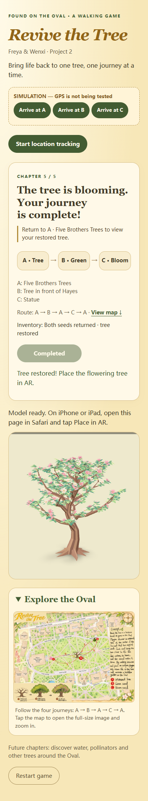

# Revive the Tree — Found on the Oval

DESIGN 4106 · Project 2 · **Freya & Wenxi**

- **Live page:** https://fwang20060226-glitch.github.io/oval/
- **Repository:** https://github.com/fwang20060226-glitch/oval
- **Route:** A (Five Brothers Trees) → B (Tree in front of Hayes) → A → C (Statue) → A
- **Intent:** Make care for the Oval's landscape tangible by asking players to walk, gather seeds, and return to restore one tree.

## Design concept

Revive the Tree is a walking AR game about restoring life to a withered tree on the Oval. Instead of discovering unrelated objects, players build a relationship with one place through repeated returns. At A, a bare tree introduces the task. Players walk to B to collect a green seed, then return to A to give it to the tree and reveal new leaves. A second journey leads to C, where a bloom seed completes the collection. Bringing it back to A transforms the tree into its flowering state. A is Five Brothers Trees, where the surrounding trees connect the dormant digital tree to living companions. B is the tree in front of Hayes, bringing a familiar campus landmark into the search for new growth. C is the statue, where the bloom seed becomes a symbolic floral offering that players carry back to the trees. The repeated outward and homeward route makes the tree's recovery depend on the participant's physical effort. Clear objectives, collected seeds, and visible changes invite the next walk. Growth plays on the webpage; each completed stage can be placed in AR. A future map can extend the route toward the Oval's edges with water, pollinator, and other tree chapters, connecting individual discoveries into a larger story of collective care.

## Game map

[Open the full-size game map](assets/oval-map.png)

The game includes this map as a zoomable image. The landscape tabloid PDF remains a separate submission deliverable.

## Preview

This is a desktop browser simulation at a phone-sized viewport, **not** an on-site AR photograph. The earlier Training 2 screenshot remains in `screenshot.png`.

## Play and demonstrate

1. Open the published HTTPS page directly in Safari on iPhone/iPad.
2. Tap **Start location tracking**, allow location, and walk to A.
3. Wait for the model to load. Use **Place in AR** to show the withered tree, then return to the webpage and begin the journey.
4. At B, collect the green seed. The seed remains available for AR while you are at B.
5. Return to A and give the seed. Watch the leaf animation once; the completed leafy tree becomes available for AR.
6. At C, collect and view the bloom seed in AR. Return to A and give it to reveal the flowering tree.
7. Use **Restart game** before a fresh demonstration. Refreshing alone preserves progress.

Growth plays once **on the webpage**. iPhone/iPad Quick Look displays the static object for the current stage; this project does not claim growth animation inside Apple's native AR viewer. Return to Safari to collect or give seeds. All seven original GLB assets remain GLB files; the viewer automatically prepares Apple's AR format when needed.

## Assets and scale

| Asset | GLB file | Size (decimal MB) |
|---|---|---:|
| Dormant tree | `models/dead.glb` | 0.46 |
| Green seed | `models/green-seed.glb` | 0.07 |
| Leafy tree | `models/leaves.glb` | 1.52 |
| Bloom seed | `models/pink-seed.glb` | 0.09 |
| Flowering tree | `models/bloom.glb` | 2.14 |
| Leaf growth | `models/grow-leaves.glb` | 3.44 |
| Flower growth | `models/grow-flowers.glb` | 3.28 |

All seven GLBs are below 5 MB. glTF units are metres: trees are approximately 3 m tall; seeds are approximately 0.24–0.26 m tall. AR uses fixed scale. Physical placement and perceived scale still require on-device verification.

## Location configuration and testing

`SPOTS` in `index.html` now contains the following recorded locations:

| Spot | Place | Latitude | Longitude | Recorded accuracy |
|---|---|---:|---:|---:|
| A | Five Brothers Trees | 39.999585 | -83.012374 | ±104 m — remeasure |
| B | Tree in front of Hayes | 40.000141 | -83.011195 | ±5 m |
| C | Statue | 39.999364 | -83.013888 | ±4 m |

The supplied A coordinate is provisional because its recorded uncertainty is much larger than the unlock radius. Remeasure A on site, ideally at ±10 m or better, then update it. The entered point centres are approximately 118 m (A–B), 131 m (A–C), and 245 m (B–C) apart; their configured 20 m radii do not overlap. These distances do not establish the accuracy of the A measurement. Each radius is 20 m; all pairs must be farther apart than the sum of their radii. Production mode refuses unconfigured or overlapping spots. `?scout` records measurements for copying into `SPOTS`.

For desktop testing, serve the folder with VS Code Live Server and open `index.html?fake`. Use the A/B/C arrival buttons. This is explicitly labelled simulation and uses separate saved progress from live play. It does **not** verify real GPS or native AR.

Model failures offer a retry without erasing progress. Animation failures fall back to the earned static tree. The model-viewer library is stored locally under `vendor/` to avoid a separate CDN dependency; the page and model files still require network access to download.

## Submission status

- Title, team names, concept and browser preview are included here.
- Working browser game: A → B → A → C → A.
- Before the live demo: remeasure A, publish the current files, and test all three unlocks and native AR placement on the intended iPhone/iPad.
- Submit the stable MP4 video (under 3 minutes), landscape tabloid PDF map, and individual portfolio links separately on Carmen. These deliverables are not represented as complete by this README.

## Credits

Built on the course's [geo-model-viewer starter](https://github.com/robillardstudio/geo-model-viewer-starter), using [model-viewer](https://modelviewer.dev/). The local model-viewer distribution retains its upstream license header. Development included AI-assisted integration, troubleshooting, and browser testing. The original Training 2 documentation is preserved in `TRAINING-2.md`.
